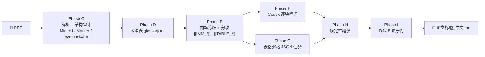

<div align="center">

# 📄→🇨🇳 academic-pdf-zh

**把英文学术论文 PDF 变成「逐句翻译、公式/表格/数字保护还原、结构逐项校验」的中文精读版 Markdown**

*一个给 AI Agent 用的翻译流水线 skill —— Agent 只负责翻译语言，脚本负责冻结关键内容、按清单还原并逐项校验结构*

[](#-流水线总览) [](demo/) [](#) [](assets/obsidian-research.css) []()

[✨ 在线演示与样章阅读站](https://da-zjy.github.io/academic-pdf-zh/) · [📖 样章阅读页](https://da-zjy.github.io/academic-pdf-zh/samples/) · [📦 快速开始](#-快速开始) · [🧪 三篇经典论文真实 Demo](demo/) · [🛡️ 为什么更难翻错](#-五道安全门)

</div>

---

## 这是什么

把一篇学术论文 PDF 交给搭载了本 skill 的 Codex，你会得到一份**可以直接放进 Obsidian 精读**的中文 Markdown：全文逐块翻译（用篇幅比与块对账防概括删减），公式、代码、URL、DOI、数字在翻译前冻结为 token、组装时按清单原样还原（不经过模型手），表格逐格翻译后由程序重建。

> **核心理念：让 LLM 只做它擅长的事（翻译语言），把「不许出错」交给确定性程序。**

普通「AI 翻译 PDF」的三种翻车方式，本 skill 用流水线针对性防御：

| 翻车现场 | 传统做法 | academic-pdf-zh |
|---|---|---|
| `2.47` 被译成 `72.47`，`y=F(x)+x` 变成不知所云 | 信任模型「注意力」 | 翻译前冻结为 token，组装时按清单还原，**篡改即报错** |
| 表格行被合并、数字串行 | 让模型输出整张表 | 表格不进自由翻译，拆成逐格 JSON 任务 + 数值清单比对 |
| 「翻译」变成「摘要」，后半段参考文献消失 | 无校验，靠感觉 | 块 ID 必须逐一对账 + 中文篇幅比例下限 + 终检报告 |

## ✨ 流水线总览



**九个阶段（Phase A–I，与 SKILL.md 一致）**：A 环境体检（`doctor.py`）→ B 锚定项目根 → C 解析与结构审计（公式/表格截图人工目检）→ D 术语表 → E 冻结与分块 → F 逐块翻译 → G 逐格翻译 → H 确定性组装 → I 终检。

## 🚀 快速开始

```powershell
# 1. 安装到你的 Codex skills 目录后，在论文目录里：
powershell -ExecutionPolicy Bypass -File <skill目录>/scripts/install.ps1
python <skill目录>/scripts/doctor.py        # 环境体检

# 2. 解析 + 审计（Linux/macOS 用 install.sh）
python <skill目录>/scripts/prepare_paper.py paper.pdf --project-root .

# 3. 按提示修复 source-audit.md 中的 MATERIAL 项（含公式截图目检）

# 4. 调用 $academic-pdf-zh —— Agent 读取审计报告、建术语表、
#    逐块翻译、填表格任务，最后输出 <论文标题>_中文.md
```

**长论文试跑**：先用 `--pages 1-3` 抽样验证解析质量，再全量运行（重新分块不会丢失已完成的翻译与表格任务，见[断点续跑](#-断点续跑)）。

## 🛡️ 五道安全门

| # | 安全门 | 机制 | 脚本 |
|---|---|---|---|
| 1 | **结构审计** | 表格数值 vs PDF 截图比对、公式页强制目检、垃圾标记检测 | `audit_source.py` |
| 2 | **内容冻结** | LaTeX/代码/URL/DOI/数字 → `[[IMM_Ixxxxxx]]`，表格 → `[[TABLE_Txxxx]]` | `chunk_markdown.py` |
| 3 | **逐格表格** | 表格拆成 cell 任务；数值 `[[TCP_Pxxx]]` 保护；模板程序重建 | `table_task_status.py` |
| 4 | **对账组装** | 块 ID 全序校验，缺失/乱序即终止；token 按清单原样还原 | `assemble_markdown.py` |
| 5 | **八项终检** | 公式集合、URL/DOI 多重集、表格数字清单、行数、图片完整性、伪标题、中文篇幅比… | `validate_translation.py` |

任何一关不过，流水线**宁可停也不产出**——这就是 "no unresolved material issue" 的含义。

## 🔁 断点续跑

长论文翻译中途被打断是常态。本 skill 的设计天然支持续跑：

- 每个分块翻译完**立即写盘**，`table_task_status.py` 随时汇报剩余单元格；
- 重新运行 `chunk_markdown.py` 会**保留已翻译的块**，并在表格原文未变时**恢复已填写的单元格译文**；
- 项目根锚定机制防止 `work/work/...` 嵌套灾难。

## 🧪 三篇经典论文真实 Demo

`demo/` 下是用真实脚本跑出的端到端样章，三篇各自的 `validation.md` 终检均为 **PASS**（样章级结果：指这些样章自身的结构终检通过，不代表全文翻译已完成，也不等于语义 100% 准确）：

| 论文 | 看什么 |
|---|---|
| [ResNet · 中文精读版](docs/samples/resnet/index.html)（[原始 Markdown](demo/resnet/resnet_中文.md)） | 式 (1)(2) 以 LaTeX 完整还原；191 个冻结 token |
| [Transformer · 中文精读版](docs/samples/transformer/index.html)（[原始 Markdown](demo/transformer/transformer_中文.md)） | Table 1 全部 20 格逐格任务化；四组注意力公式逐字校对 |
| [DeepSeek-R1 · 中文精读版](docs/samples/deepseek-r1/index.html)（[原始 Markdown](demo/deepseek-r1/deepseek-r1_中文.md)） | GRPO 目标函数；aha-moment 表格 15 个数字 token 保护 |

每个文件夹附带 `validation.md`（终检证据）、`source-audit.md`（审计证据）与分块/表格任务样本。站内阅读页与校验报告页由 `scripts/build_site.py` 从这些文件自动生成（`python scripts/build_site.py`），不手工维护两套译文。

**36 秒动效演示**：[docs/index.html](docs/index.html) 内嵌可播放/暂停/拖动进度的动画（数据由 `scripts/build_demo_data.py` 从上述真实产物生成，标注「基于已有样章的流程演示，播放经过编排」）；[docs/player.html](docs/player.html) 为无干扰录制视图，支持 `?t=秒` 直接定位任意时刻。关键帧截图见 [docs/screenshots/](docs/screenshots/)。

## 📖 阅读体验约定

- 抹平 PDF 页眉页码，跨页断句自动接回；图内文字收进可折叠 `<details>`；
- 图注紧贴图/表下方；宽表格保持 HTML，配合 [Obsidian CSS 片段](assets/obsidian-research.css)横向滚动；
- 机构名译中、作者名与模型名保留原文；参考文献条目符合学术惯例；
- 默认只产出忠实翻译；`reading-notes.md`（精读笔记）仅在用户明确要求时另行生成。

## 📁 目录结构

```text
academic-pdf-zh/
├── SKILL.md                  # Agent 读取的执行剧本（Phase A–I）
├── scripts/                  # 流水线全部脚本（见五道安全门）
├── references/               # 翻译合同 / 审计指南 / 解析指南
├── assets/obsidian-research.css
├── docs/index.html           # ✨ 项目主页（动效展示）
├── demo/                     # 🧪 三篇经典论文端到端样章
└── tests/smoke_test.py
```

## 🧭 设计原则

1. **Translate, never summarize** —— 逐句忠实是第一优先级，禁用外部翻译 API，翻译由 Agent 本体完成；
2. **不确定就去看 PDF** —— 公式/表格损坏时不许凭领域知识脑补，必须调出页面截图核对；
3. **一切可验证** —— 每个阶段留下可检查的证据（审计报告、任务 JSON、终检报告），"完成"由证据定义，不由感觉定义。

---

<div align="center">

**如果这个 skill 帮你省下了精读论文的时间，欢迎 Star ⭐**

*ResNet · Transformer · DeepSeek-R1 端到端样章，就在 [demo/](demo/)*

</div>
