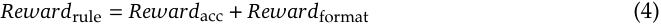
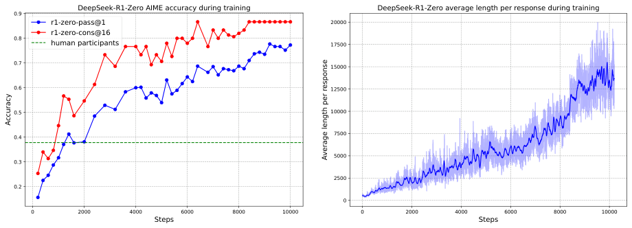

---
cssclasses:
  - research-paper
---

# **DeepSeek-R1：通过强化学习激励大语言模型的推理能力**
DeepSeek-AI
```
research@deepseek.com
```
## **摘要**
通用推理是人工智能领域一项长期存在的艰巨挑战。以大语言模型（LLMs）（Brown et al., 2020；OpenAI, 2023）与思维链提示（Wei et al., 2022b）为代表的近期突破，已在基础推理任务上取得了相当大的成功。然而，这一成功严重依赖于大量的人工标注示范，且模型的能力对于更复杂的问题仍然不足。在此，我们展示了大语言模型的推理能力可以通过纯强化学习（RL）被激励出来，从而无需人工标注的推理轨迹。所提出的强化学习框架促进了高级推理模式的涌现式发展，例如自我反思、验证与动态策略调整。由此训练出的模型在数学、编程竞赛与 STEM 领域等可验证任务上取得了卓越的性能，超越了通过在人类示范上进行传统监督学习训练出的对应模型。此外，这些大规模模型所表现出的涌现推理模式，可以被系统地加以利用，用于引导并增强较小模型的推理能力。
### **1. 引言**
推理能力是人类智力的基石，使从数学问题求解到逻辑推演与编程等复杂认知任务成为可能。人工智能领域的最新进展表明，大语言模型（LLMs）在扩展到足够规模时能够表现出包括推理能力在内的涌现行为（Kaplan et al., 2020；Wei et al., 2022a）。然而，在预训练中实现此类能力通常需要大量的计算资源。与此并行，一条互补的研究路线表明，大语言模型可以通过思维链（CoT）提示得到有效增强。这一技术要么提供精心设计的少样本示例，要么使用"Let's think step by step"这类极简提示（Kojima et al., 2022；Wei et al., 2022b），使模型能够产出中间推理步骤，从而大幅提升其在复杂任务上的表现。类似地，当模型在后训练阶段学习高质量的多步推理轨迹时，也观察到了进一步的性能增益（Chung et al., 2024；OpenAI, 2023）。尽管行之有效，这些方法仍存在明显的局限。它们对人工标注推理轨迹的依赖阻碍了可扩展性，并引入了认知偏差。此外，将模型约束为复制人类的思维过程，使其性能在本质上被人类提供的范例所封顶，从而阻碍了对更优的、非人类式推理路径的探索。
为解决这些问题，我们旨在探索大语言模型在强化学习框架中通过自我进化发展推理能力的潜力，同时将对人工标注工作的依赖降至最低。具体而言，我们以 DeepSeek-V3-Base（DeepSeek-AI, 2024b）为基础，采用群组相对策略优化（GRPO）（Shao et al., 2024）作为我们的强化学习框架。奖励信号仅基于最终预测相对于标准答案的正确性，而不对推理过程本身施加任何约束。值得注意的是，我们跳过了强化学习训练之前常规的监督微调（SFT）阶段。这一设计选择源于我们的假设：人类定义的推理模式可能会限制模型的探索，而无约束的强化学习训练能够更好地激励大语言模型涌现出新颖的推理能力。通过第 2, 节详述的这一过程，我们的模型（称为 DeepSeek-R1-Zero）自然地发展出了多样且复杂的推理行为。在解决推理问题时，模型表现出生成更长回答的倾向，会在每个回答中纳入验证、反思以及对备选方法的探索。尽管我们并未显式地教模型如何推理，它还是通过强化学习成功地学到了更好的推理策略。
尽管 DeepSeek-R1-Zero 展现出了出色的推理能力，它仍面临可读性差与语言混杂等挑战，会在单条思维链回答中时而混用英文与中文。此外，DeepSeek-R1-Zero 基于规则的强化学习训练阶段过于聚焦于推理任务，导致其在写作、开放式问答等更广泛领域中的表现有限。为应对这些挑战，我们提出了 DeepSeek-R1——一个通过整合拒绝采样、强化学习与监督微调的多阶段学习框架训练得到的模型，详见第 3 节。这一训练流水线使 DeepSeek-R1 能够继承其前身 DeepSeek-R1-Zero 的推理能力，同时通过额外的非推理数据将模型行为与人类偏好对齐。
为了让更强大的 AI 以更低的能耗被更广泛地使用，我们蒸馏了若干较小的模型并将其公开。这些蒸馏模型展现出强大的推理能力，超越了其原始指令微调版本的性能。我们相信，这些指令微调版本也将为研究社区做出显著贡献：它们为理解长思维链（CoT）推理模型的底层机制提供了宝贵资源，并有助于培育更强大的推理模型。我们将 DeepSeek-R1 系列模型公开发布于 `https://huggingface.co/deepseek-ai` (Hugging Face)。
### **2. DeepSeek-R1-Zero**
我们首先详述 DeepSeek-R1-Zero 的训练，它完全依赖强化学习而无需监督微调。为提升大规模强化学习的效率，我们采用群组相对策略优化（GRPO）（Shao et al., 2024）。
#### **2.1. 群组相对策略优化**
GRPO（Shao et al., 2024）是我们用来训练 DeepSeek-R1-Zero 与 DeepSeek-R1 的强化学习算法。它最初被提出是为了简化训练过程并降低近端策略优化（PPO）（Schulman et al., 2017）的资源消耗，后者被广泛用于大语言模型的强化学习阶段（Ouyang et al., 2022）。
对于每个问题 $q$，GRPO 从旧策略 $\pi_{\theta_{\text{old}}}$ 中采样一组输出 $\{o_1, o_2, \cdots, o_G\}$，然后通过最大化以下目标来优化策略模型 $\pi_\theta$：
$$\mathcal{J}_{GRPO}(\theta) = \mathbb{E}\left[q \sim P(Q), \{o_i\}_{i=1}^{G} \sim \pi_{\theta_{\text{old}}}(O|q)\right] \\ \frac{1}{G}\sum_{i=1}^{G}\left(\min\left(\frac{\pi_\theta(o_i|q)}{\pi_{\theta_{\text{old}}}(o_i|q)}A_i, \text{clip}\left(\frac{\pi_\theta(o_i|q)}{\pi_{\theta_{\text{old}}}(o_i|q)}, 1-\varepsilon, 1+\varepsilon\right)A_i\right) - \beta\mathbb{D}_{KL}\left(\pi_\theta\|\pi_{ref}\right)\right), \tag{1}$$
$$\mathbb{D}_{KL}\left(\pi_\theta\|\pi_{ref}\right) = \frac{\pi_{ref}(o_i|q)}{\pi_\theta(o_i|q)} - \log\frac{\pi_{ref}(o_i|q)}{\pi_\theta(o_i|q)} - 1, \tag{2}$$
其中 $\pi_{ref}$ 是参考策略，$\varepsilon$ 与 $\beta$ 是超参数，$A_i$ 是优势（advantage），它使用与每组内各输出相对应的一组奖励 $\{r_1, r_2, \ldots, r_G\}$ 来计算：
$$A_i = \frac{r_i - \text{mean}(\{r_1, r_2, \cdots, r_G\})}{\text{std}(\{r_1, r_2, \cdots, r_G\})}. \tag{3}$$
我们在补充材料 A.3 中给出了 GRPO 与 PPO 的比较。为训练 DeepSeek-R1-Zero，我们将学习率设为 3e-6，KL 系数设为 0.001，并将 rollout 的采样温度设为 1。对于每个问题，在 8.2k 步之前，我们采样 16 个最大长度为 32,768 个词元的输出；此后最大长度为 65,536 个词元。结果显示，DeepSeek-R1-Zero 的性能与回答长度都在 8.2k 步处出现了显著跃升，训练总计持续 10,400 步，对应 1.6 个训练轮次。每个训练步由 32 个不同的问题组成，因此训练批大小为 512。每 400 步，我们用最新的策略模型替换参考模型。为加速训练，每次 rollout 生成 8,192 个输出，随机划分为 16 个迷你批次，且仅训练单个内部轮次。
**表 1 | DeepSeek-R1-Zero 的模板。** `prompt` 会在训练期间被替换为具体的推理问题。

> 一次用户（User）与助手（Assistant）之间的对话。用户提出一个问题，助手解决它。助手先在心中思考推理过程，然后向用户提供答案。推理过程与答案分别置于 `<think>...</think>` 与 `<answer>...</answer>` 标签内，即：`<think>` 推理过程 `</think> <answer>` 答案 `</answer>`。用户：`prompt`。助手：
我们的高性能强化学习基础设施在补充材料 B.1, 中描述，它保证了可扩展且高效的训练。
#### **2.2. 奖励设计**
奖励是训练信号的来源，它决定强化学习优化的方向。对于 DeepSeek-R1-Zero，我们采用基于规则的奖励，为数学、编程与逻辑推理领域的数据提供精确的反馈。我们基于规则的奖励系统主要由两类奖励构成：准确性奖励与格式奖励。
**准确性奖励**评估回答是否正确。例如，对于结果确定性的数学题，模型被要求以指定格式（例如放在一个方框内）给出最终答案，从而能够基于规则可靠地验证其正确性。类似地，对于编程竞赛题目，可以利用编译器，针对一组预定义的测试用例评估模型的回答，从而生成关于正确性的客观反馈。
**格式奖励**通过强制特定的格式要求来补充准确性奖励模型。特别地，我们激励模型将其推理过程封装进指定的标签，即 '`<think>`' 与 '`</think>`'。这保证了模型的思考过程被显式地界定，从而增强可解释性并便于后续分析。

准确性奖励与格式奖励以相同的权重相加。值得注意的是，我们避免将神经奖励模型——无论是基于结果的还是基于过程的——应用于推理任务。这一决定基于我们的观察：在大规模强化学习过程中，神经奖励模型容易受到奖励破解（reward hacking）的影响。此外，重新训练此类模型需要大量计算资源，并会给训练流水线引入额外复杂性，从而使整体优化过程更加复杂。
#### **2.3. 激励大语言模型的推理能力**
具体而言，我们在 DeepSeek-V3 基座模型上应用强化学习技术来训练 DeepSeek-R1-Zero。在训练过程中，我们设计了一个直截了当的模板，要求 DeepSeek-R1-Zero 先产出推理过程，再给出最终答案。我们有意把约束限定在这一结构性格式之内，避免任何内容层面的偏向，以确保能够准确观察模型在强化学习过程中的自然演进。

<details>
<summary>图内文字（原文提取，待翻译）</summary>

0.9 DeepSeek-R1-Zero 训练期间的 AIME 准确率 DeepSeek-R1-Zero 训练期间的平均回答长度
r1-zero-pass@1 20000
0.8 r1-zero-cons@16
人类参赛者 17500
0.7 15000
0.6 12500
0.5 10000
0.4 7500
5000
0.3
2500
0.2
0
0 2000 4000 6000 8000 10000 0 2000 4000 6000 8000 10000
步数 步数
准确率
每次回答的平均长度

</details>
图 1 |（a）DeepSeek-R1-Zero 训练期间的 AIME 准确率。AIME 以一道数学题作为输入、以一个数作为输出，示例如表 32 所示。Pass@1 与 Cons@16 在补充材料 D.1 中描述。基线是 AIME 竞赛中人类参赛者取得的平均分。（b）强化学习过程中 DeepSeek-R1-Zero 在训练集上的平均回答长度。DeepSeek-R1-Zero 自然地学会用更多思考时间来解决推理任务。注意，一个训练步指的是一次策略更新操作。
图 1（a）描绘了 DeepSeek-R1-Zero 在强化学习训练全程中于 AIME 2024 基准上的性能轨迹：在 AIME 2024 上的平均 pass@1 得分显著上升，从最初的 15.6% 跃升至 77.9%。此外，借助自一致性解码（Wang et al., 2023c），模型的性能还可以进一步提升，达到 86.7% 的准确率。这一表现显著超越了所有人类参赛者的平均成绩。除了数学竞赛之外，如图 10, 所示，DeepSeek-R1-Zero 在编程竞赛以及研究生水平的生物、物理与化学问题上同样取得了出色的成绩。这些结果凸显了强化学习在增强大语言模型推理能力方面的有效性。
**表 2 | DeepSeek-R1-Zero 某个中间版本一个有趣的"aha 时刻"。** 模型学会了以拟人化的语气进行重新思考。对我们而言，这同样是一个 aha 时刻——让我们得以见证强化学习的力量与美。

|问题|若 $a > 1$，那么 $\sqrt{a - \sqrt{a + x}} = x$ 的全部实数解之和等于|
|---|---|
|回答|<think> 为求解方程 $\sqrt{a - \sqrt{a + x}} = x$，我们先对方程两边平方 $\cdots$ $\left(\sqrt{a - \sqrt{a+x}}\right)^2 = x^2 \implies a - \sqrt{a+x} = x^2$。整理以分离内层平方根项：$(a - x^2)^2 = a + x \implies a^2 - 2ax^2 + (x^2)^2 = a + x \implies x^4 - 2ax^2 - x + (a^2 - a) = 0$ $\cdots$ 等等，等等，等等。这是我能够在此标记的一个“aha 时刻”。让我们逐步重新评估，确认正确的解之和是否可以为 $\cdots$ 我们从方程开始：$\sqrt{a - \sqrt{a+x}} = x$ 首先，对方程两边平方：$a - \sqrt{a+x} = x^2 \implies \sqrt{a+x} = a - x^2$ 接下来，我可以再次对方程两边平方，把方程视为：$\cdots$ $\cdots$|
DeepSeek-R1-Zero 的自我进化例证了强化学习如何能够自主地增强模型的推理能力。
如图 1（b）所示，DeepSeek-R1-Zero 在整个训练过程中的思考时间稳步增加，这一增长完全由内在的自适应驱动，而非外部修改所致。借助长思维链，模型逐步打磨其推理，生成成百上千个词元来探索并改进其问题求解策略。
思考时间的增加促进了复杂行为的自主发展。具体而言，DeepSeek-R1-Zero 愈发展现出高级推理策略，如反思性推理以及对备选解法的系统性探索（详见补充材料 C.2 的图 9（a）），从而显著提升了其在数学与编程等可验证任务上的表现。值得注意的是，在训练过程中，DeepSeek-R1-Zero 表现出一个"aha 时刻"（表 2），其特征是在反思过程中"wait"一词的使用突然增多（详见补充材料 C.2 的图 9（b））。这一时刻标志着推理模式的显著转变，清晰地展示了 DeepSeek-R1-Zero 的自我进化过程。
DeepSeek-R1-Zero 的自我进化凸显了强化学习的力量与美：我们无需显式地教模型如何解决一个问题，只需提供恰当的激励，它便会自主地发展出高级的问题求解策略。这也提醒我们，强化学习有潜力释放大语言模型更高层次的能力，为未来更加自主、更加自适应的模型铺平道路。

---

> **说明**：本文件为 `academic-pdf-zh` skill 的端到端演示样章（DeepSeek-R1 第 1–5 页节选），由流水线真实产出：解析 → 结构审计 → 内容冻结（含 GRPO 公式与 aha-moment 表格中 15 个数字 token）→ 分块翻译 → 逐格表格任务 → 确定性组装 → 终检 **PASS**（见 `validation.md`）。非完整论文翻译。
